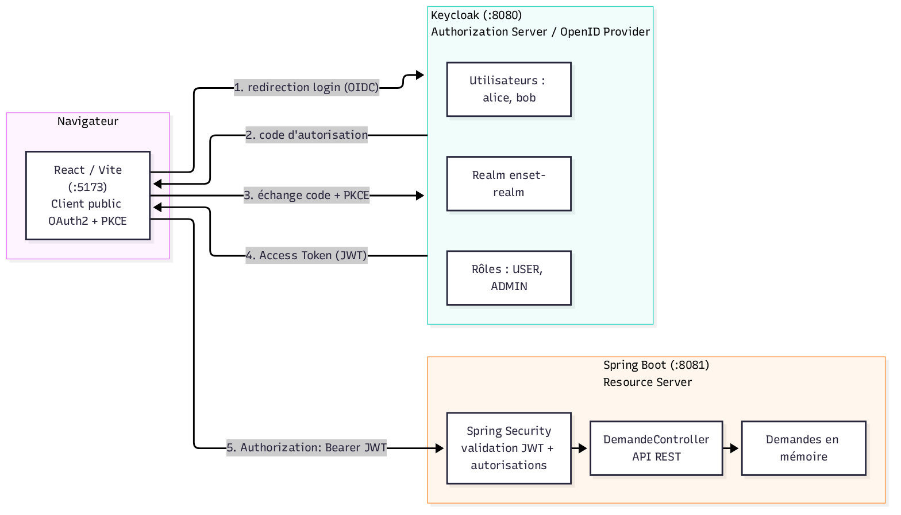
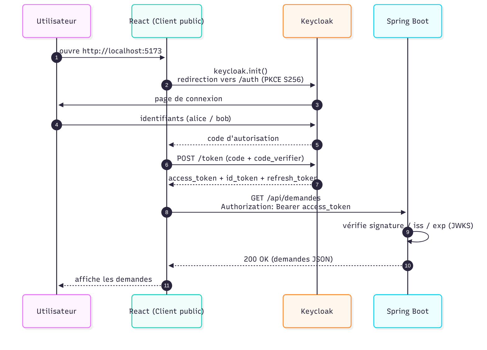
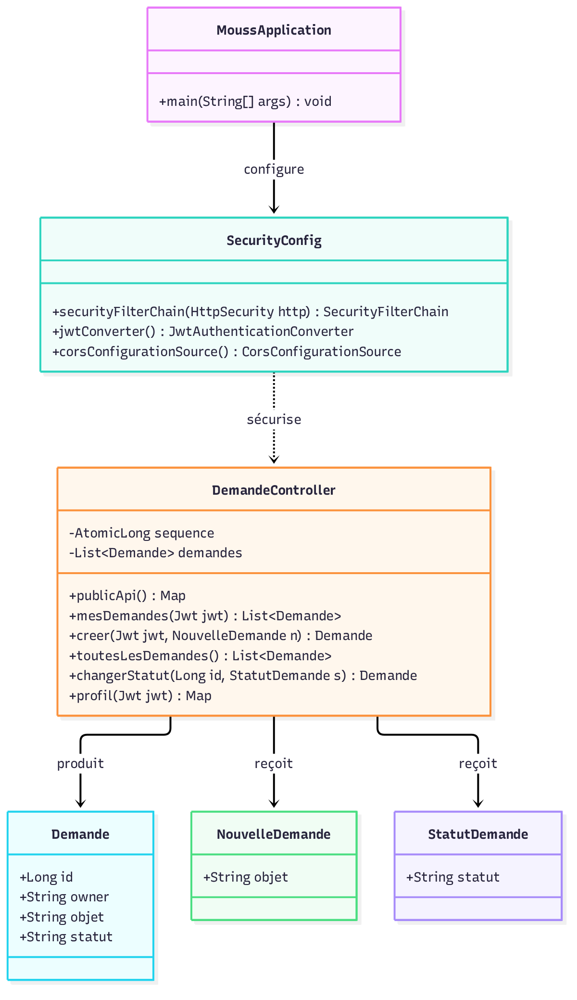

# Atelier pratique : OAuth 2.0 / OpenID Connect

Sécurisation d'une application **React + Spring Boot** avec **Keycloak** (module *Sécurité des
systèmes distribués*).

## Architecture

| Composant            | Technologie   | Port |
|----------------------|---------------|------|
| Serveur d'identité   | Keycloak      | 8080 |
| API sécurisée        | Spring Boot   | 8081 |
| Frontend             | React / Vite  | 5173 |

```
React (client public, PKCE)
   └─(1) redirection login ─▶ Keycloak (Authorization Server / OpenID Provider)
   ◀─(2) code d'autorisation
   └─(3) échange code+PKCE ─▶ jetons (Access Token, ID Token)
   └─(4) Authorization: Bearer <token> ─▶ Spring Boot (Resource Server)
```

## Diagrammes

### Architecture



### Flux OAuth 2.0 / OIDC (Authorization Code + PKCE)



### Diagramme de classes (backend Spring Boot)



## Prérequis

- Docker (pour Keycloak)
- Java 17 ou 21
- Maven (le wrapper `./mvnw` est fourni)
- Node.js + npm

## 1. Démarrer Keycloak

```bash
docker compose up -d
docker compose logs -f keycloak   # attendre "Running the server in development mode"
```

Console d'administration : <http://localhost:8080> — `admin` / `admin`.

## 2. Configurer Keycloak (manuel)

1. **Realm** : créer un realm nommé `enset-realm`.
2. **Client** (`Clients` → `Create client`) :
   - Client type : `OpenID Connect`
   - Client ID : `react-client`
   - Client authentication : `Off`
   - Standard flow : `On`, Implicit flow : `Off`, Direct access grants : `Off`
   - Root URL : `http://localhost:5173/`
   - Home URL : `http://localhost:5173/`
   - Valid redirect URIs : `http://localhost:5173/*`
   - Web origins : `http://localhost:5173`
   - PKCE Code Challenge Method : `S256`
3. **Realm roles** : créer `USER` et `ADMIN`.
4. **Users** : créer deux utilisateurs (mot de passe, `Temporary` désactivé, `Role mapping`) :

   | Utilisateur | Mot de passe | Rôles        |
   |-------------|--------------|--------------|
   | alice       | alice123     | USER         |
   | bob         | bob123       | USER, ADMIN  |

## 3. Démarrer l'API Spring Boot (Resource Server)

```bash
./mvnw spring-boot:run
```

- `GET http://localhost:8081/api/public` → `{"message":"API publique accessible"}`
- `GET http://localhost:8081/api/demandes` sans token → `401 Unauthorized`

## 4. Démarrer le frontend React

```bash
cd frontend
npm install
npm run dev
```

Ouvrir <http://localhost:5173> : redirection automatique vers la page de connexion Keycloak.

## 5. Tests

### Fonctionnels (navigateur)

- **alice** (`USER`) : crée une demande, consulte ses demandes, **pas** de panneau admin.
- **bob** (`USER, ADMIN`) : voit le panneau admin, consulte toutes les demandes, peut
  **valider** ou **refuser** une demande.

### Sécurité (Postman)

| Test                                              | Résultat attendu |
|---------------------------------------------------|------------------|
| `GET /api/demandes` sans token                    | `401`            |
| `GET /api/demandes` avec token invalide           | `401`            |
| `GET /api/admin/demandes` avec token alice (USER) | `403`            |
| `GET /api/admin/demandes` avec token bob (ADMIN)  | `200`            |
| `PATCH /api/admin/demandes/{id}` (USER)           | `403`            |
| `PATCH /api/admin/demandes/{id}` (ADMIN)          | `200`            |

Tests automatisés du backend :

```bash
./mvnw test
```

## Travail supplémentaire (implémenté)

1. **Refuser une demande** : bouton `Refuser` (réservé à `ADMIN`) qui envoie un
   `PATCH` avec `statut = REFUSEE`.
2. **Profil utilisateur** : endpoint `GET /api/profil` renvoyant `{ "id", "username" }` extraits
   du JWT (`sub` et `preferred_username`).
3. **Tests de sécurité** : couverts par `SecurityTests`.

> ⚠️ Ne jamais publier un Access Token réel. Les jetons sont conservés en mémoire par Keycloak JS
> (ne pas les copier dans `localStorage`).
